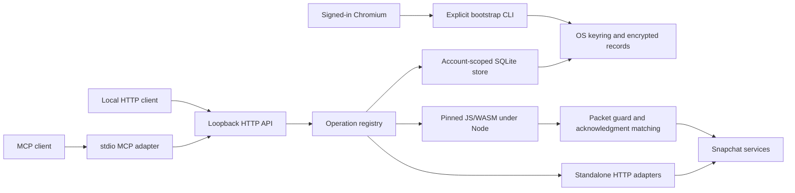

# Architecture

## Shared interface

`internal/service/core.go` defines schemas, availability, and dispatch. HTTP
routes derive from operation names. MCP forwards to that same authenticated HTTP
API with the same result envelope. OpenAPI is generated from the registry.
Unavailable entries return `unsupported_capability` and remain clearly labeled.

## Storage and authentication

`store.go` stores accounts, exclusions, conversations, local events, jobs, and
delivery receipts. Credentials and sensitive protocol state are sealed through
`vault.go`, backed by an explicitly provisioned OS keyring master key. Bootstrap
captures an existing browser session and identity material. Standalone refresh
can renew captured credentials without Chromium.

## Protocol execution

Read adapters implement Atlas sync, conversation pagination, incoming requests,
public identity, and own story status. Text history filters media without marking
messages read. Messaging runs pinned Snapchat assets under Node. Runtime network
requests are allowlisted and diagnostics reduced to safe metadata. Each native
delegate has a separate object to avoid Djinni proxy identity reuse.

Media upload encrypts locally and stores an account-bound handle. During snap
preparation, the upload delegate resolves that handle and attaches AES metadata.
Direct messaging uses native EEL policy; tested groups use TLS-only message
envelopes. Uploaded media itself is encrypted in both cases.

## Delivery lifecycle

1. Validate account, exclusions, recipient relationship, and membership.
2. Bind a stable idempotency key to the payload and persist the attempt.
3. Synchronize membership and build the native message.
4. Validate destination, wire content type, encryption, and media object.
5. Preparation stops here. Sending submits once.
6. Match the RPC response to destination and client resolution ID.
7. Persist `sent`, `not_sent`, or conservative `unknown` status.

Acknowledged keys replay a receipt. Unknown attempts never automatically resubmit.
An acknowledgment confirms server acceptance, not recipient playback. Local events
are service activity, not a remote Snapchat notification feed.
